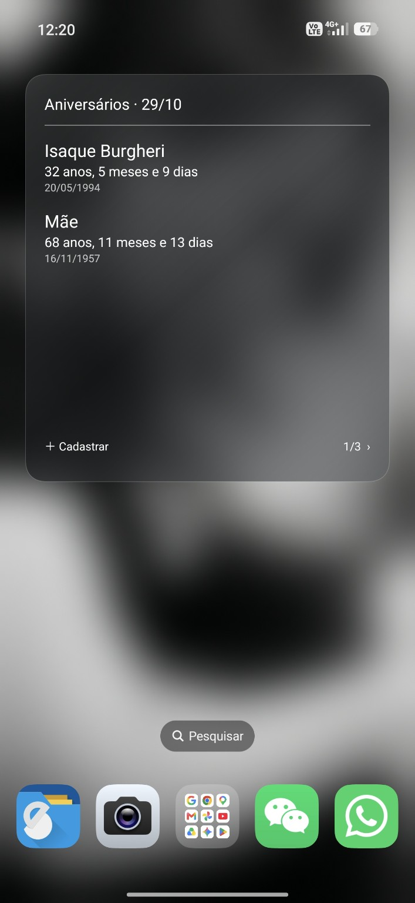

# Aniversários Android

Widget de aniversários com cadastro local e idade em anos, meses e dias.

## Visual do widget

## Versão 1.2
O botão central do rodapé alterna entre **Idade** (mais velhos primeiro) e **Data** (mês e dia, de janeiro a dezembro, ignorando o ano de nascimento).
O texto indica a ordem atual. A escolha fica salva e vale para todos os widgets, inclusive após atualizar ou reiniciar o aparelho. O padrão é mais velhos primeiro.
Os cadastros não são reordenados nem alterados; a ordenação afeta a exibição no widget.

## Versão 1.1
Todos os aniversários aparecem em uma lista única com rolagem vertical dentro do widget, sem paginação.
O cabeçalho e os botões Cadastrar e Atualizar ficam fixos. O visual translúcido foi mantido.
O identificador do aplicativo e os dados locais continuam iguais aos da versão 1.0.

## Baixar o APK
Abra **Actions → Gerar APK → execução concluída → Artifacts → Aniversarios-APK**. Extraia o ZIP e instale o APK no Android 8 ou superior.

Para gerar novamente, use **Run workflow**. Novos commits em main também iniciam a compilação.

O APK é uma versão de teste assinada automaticamente. Builds em máquinas distintas podem usar chaves diferentes. Se o Android recusar a atualização, não desinstale sem preservar os cadastros: desinstalar apaga os dados.

O painel é translúcido, sem desfoque real do papel de parede. O widget solicita atualização a cada 30 minutos, sujeita à economia de bateria do Android.
